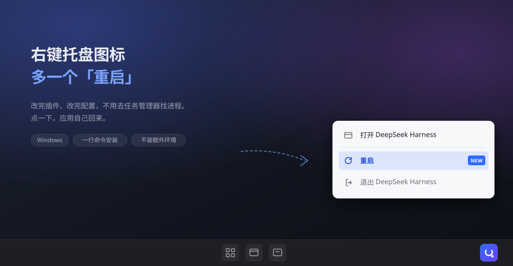
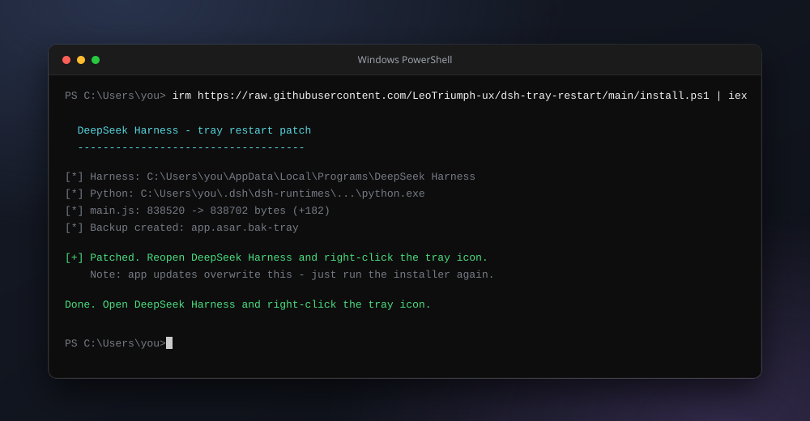

<p align="center">
  
</p>

<h1 align="center">dsh-tray-restart</h1>

<p align="center">
  给 <b>DeepSeek Harness</b> 的系统托盘加一个「重启」。
  <br>
  改完插件、改完配置，不用去任务管理器找进程。
</p>

<p align="center">
  
  
  
</p>

---

## 安装

打开 PowerShell，粘一行：

```powershell
irm https://raw.githubusercontent.com/LeoTriumph-ux/dsh-tray-restart/main/install.ps1 | iex
```

<p align="center">
  
</p>

**不需要装 Node、Python 或任何环境** —— 脚本会用 Harness 自己带的 Python。

装完重新打开 Harness，右键托盘图标：

```
打开 DeepSeek Harness
────────────────
重启              ← 新增
退出 DeepSeek Harness
```

## 卸载

```powershell
irm https://raw.githubusercontent.com/LeoTriumph-ux/dsh-tray-restart/main/uninstall.ps1 | iex
```

会把 `app.asar` 还原成打补丁之前的样子。

## 常见问题

**升级 Harness 后「重启」不见了？**

正常的。Harness 自动更新会重写 `app.asar`，把这个改动覆盖掉。重跑一次安装命令就好，不用卸载。

**提示 `app.asar is locked`？**

Harness 还开着，文件被占用。先从托盘菜单退出，再跑安装命令。

**提示 `Anchor not found`？**

说明你这个 Harness 版本的主进程代码和我测试的不一样。脚本会**安全退出，不会动你的文件**，Harness 毫发无损。带上版本号开个 issue，我适配一下。

**杀毒软件报警？**

脚本会改写 Harness 的 `app.asar`，这类行为容易触发启发式告警。整个过程开源，`patch.py` 不到 300 行，改了什么一目了然：只往托盘菜单里插一项，不碰任何业务逻辑。

**会影响 Harness 更新吗？**

不影响。它不知道 `app.asar` 被改过，照常更新——只是更新后补丁没了，重跑一次即可。

**我的配置和会话会丢吗？**

不会。补丁只动 `resources/app.asar` 里托盘菜单的那两行代码，跟 `~/.dsh` 下的数据完全无关。

**为什么不做成插件？**

做不了。Harness 的插件跑在渲染进程里，而系统托盘是 Electron **主进程**的对象，插件根本拿不到托盘句柄。只能改主进程代码。

## 它改了什么

就两处，都在 `lib/main.js` 的 `DesktopTray` 里：

```diff
  tray.setContextMenu(Menu.buildFromTemplate([
    { label: messages.openApplication, click: () => this.options.open() },
    { type: "separator" },
+   { label: messages.restartApplication ?? "重启",
+     click: () => { this.options.restart?.(); } },
    { label: messages.quitApplication, click: () => this.options.quit() },
  ]));

  tray = new DesktopTray({
    iconPath, locale,
    open: () => focusPrimaryWindow(),
    quit: () => { app.quit(); },
+   restart: () => { app.relaunch(); app.exit(0); },
  });
```

重启走的是 Electron 官方的 `app.relaunch()`，和 Harness 自己退出的路径一致：会复用原来的命令行参数（比如 `--disable-gpu`），不会丢。

## 兼容性

| | |
|---|---|
| 系统 | Windows（macOS 的托盘代码路径不同，没做） |
| 测试版本 | DeepSeek Harness **0.2.2-rc.1** |
| Python | 不需要另装，用 Harness 自带的 |

版本不匹配时脚本会拒绝执行并保留原文件，不会把应用搞坏。

## 手动安装

不想用一行命令，或者想先看看脚本做了什么的：

```bash
git clone https://github.com/LeoTriumph-ux/dsh-tray-restart.git
cd dsh-tray-restart
python patch.py
```

```bash
# 装在非默认位置时，手动指定 app.asar
python patch.py "D:\path\to\resources\app.asar"

# 还原
python restore.py
```

需要 Python 3.7+。Harness 自带的那个在：

```
%USERPROFILE%\.dsh\dsh-runtimes\dsh-primary-runtime\dependencies\python\python.exe
```

双击 `install.bat` 也行，效果一样。

## License

MIT
